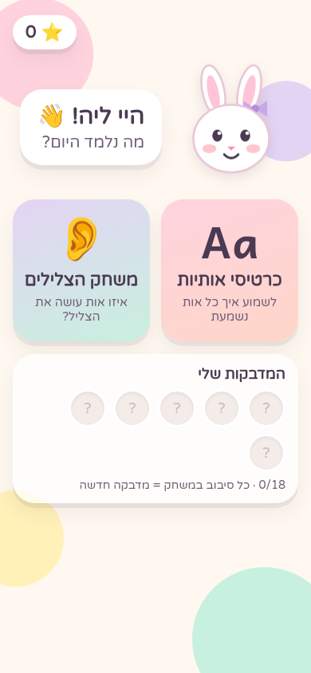
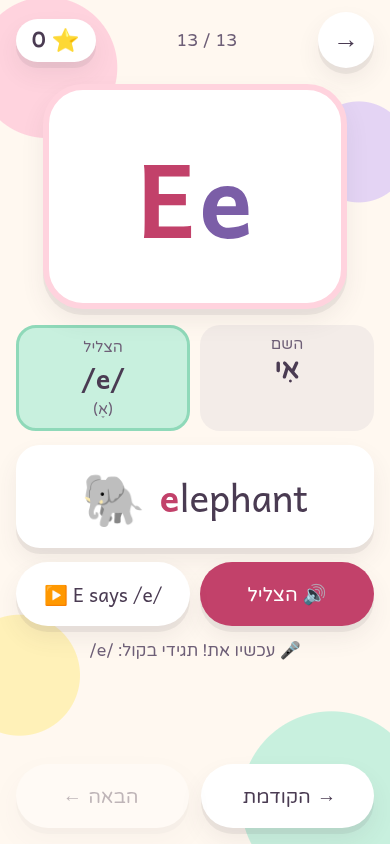
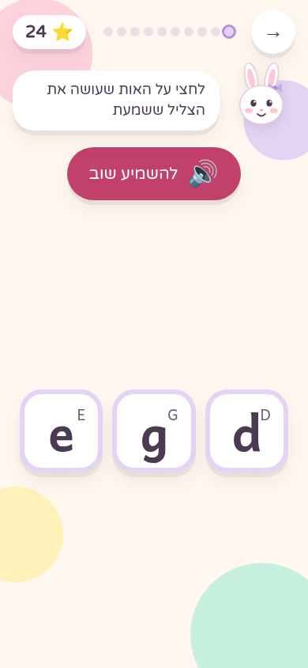
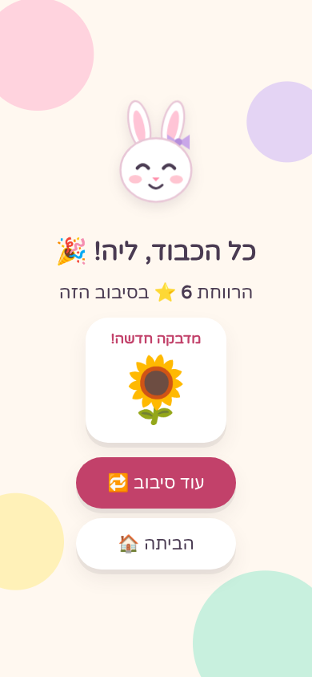

# Lia English 🐰

A small, personal phonics app that teaches Lia (4th grade, Hebrew speaker) the **sound** and **shape** of English letters.
Touch-first PWA for phone and tablet, both orientations. UI instructions are in Hebrew (RTL); learning content is in English.

**Live preview:** https://idocodev.github.io/lia-english/

| Home | Letter card | Sound game | Round end |
| --- | --- | --- | --- |
|  |  |  |  |

## What's in the POC

- **Home**: Mimi the bunny (original art) greets Lia by name, two big activities, star counter, sticker shelf.
- **Letter cards**: the first set in phonics order, `s a t p i n m d g o c k e` (with `e` for E/G practice).
  Big upper + lower case letter, keyword with a picture (🐐 goat), and the letter's **name** shown apart from its
  **sound** (`השם: גִ׳י · הצליל: /g/`), since mixing up names is where E/G confusion comes from.
  Opens with "G says /g/, like goat"; tap the letter or buttons to hear it again.
- **Sound game**: hear a sound, pick the letter out of 2 (or 3 once a letter gets stable).
  - Distractors come from known confusion pairs first (E/G now; b/d and p/q activate once those letters are added),
    then from letters Lia actually mixed up, then random. Letters with the same sound (c/k) are never offered together.
  - A miss is never a red "wrong": both letters are played side by side ("this is /g/, and this is /e/"), then she tries again.
  - Adaptive: Leitner boxes per letter; missed letters weigh more and come back 2 questions later in the same round.
- **First words** (`src/content/words.ts`): 29 short words built from single letter sounds (cat, hat, cap, pen, pig,
  dog, sun, bus...), each with an OpenMoji picture. A word joins the games once all its letters are in the sound game.
  Two games, both on the play screen (`#/play`, the raised button in the tab bar) and on home:
  - **שמע ובחר** (`#/words/pick`): hear a word, pick its picture out of 3. The other pictures are words one sound
    away when there are some (cat / hat / cap), then words she mixed it up with. A miss says what she tapped
    ("this is hat") and plays the word again.
  - **בנה את המילה** (`#/words/build`): hear the word and see its picture, then tap letter tiles into the slots,
    left to right. Each tile says its sound; tiles are the word's letters plus 1 extra (2 once the word is known):
    another short vowel and a letter she confuses (b/d...), never one that sounds the same (c/k). A wrong tile shakes,
    says its sound and goes back; after 2 misses on a slot the right tile glows. A built word is blended slowly,
    sound by sound with its slot lit, then said whole.
  - Same engine as letters: Leitner boxes per word (missed words come back in the round), stars, XP, a sticker per
    round, and a "בונת מילים" badge. Answers sync like letter answers: `game` = `word-pick` / `word-build`,
    `letter` = the word, `chosen` = the picked word or the word as her first wrong tile spelled it (`cat` -> `uat`);
    word rounds' ids start with the game id. No database change.
  - To add a word: add it to `words.ts` with its OpenMoji hexcode, run `node scripts/get-pictures.mjs` (the picture)
    and `python scripts/gen-audio.py --words` (its clip, keeps every other clip), then bump `CACHE` in `public/sw.js`.
- **Rewards**: a star per first-try answer, a sticker after each 10-question round, short sparkle bursts and chimes.
- **Progress** stays on the device (`localStorage`), including an append-only attempt log ready for syncing later.
- **PWA**: manifest, icons and a small service worker, so it can be added to the home screen and works offline.

## Run it

```bash
npm install
npm run dev       # http://localhost:5173
npm test          # engine unit tests (Vitest)
npm run build     # production build in dist/
```

Every push to `main` builds, tests and publishes `dist/` to the `gh-pages` branch (`.github/workflows/deploy.yml`).

## Code map

```
src/
  content/letters.ts   letters, names, sounds, keywords, confusion pairs (one typed file)
  content/words.ts     first words + their OpenMoji pictures (public/pictures, scripts/get-pictures.mjs)
  content/stickers.ts  sticker set
  engine/words.ts      word games: picture distractors, letter tiles (pure, tested)
  engine/engine.ts     adaptive engine: Leitner boxes, weighted picks, distractors, rounds (pure, tested)
  audio/audio.ts       the audio seam: recorded files first, Web Speech API fallback
  storage/local.ts     localStorage save/load, attempt log (the offline source of truth)
  storage/journal.ts   the save as events: diff, merge from the cloud, outbox (pure, tested)
  storage/sync.ts      cloud save: outbox + retry, pull; storage/remote.ts = Supabase (lazy-loaded)
  storage/account.ts   login/register, the device's account
supabase/schema.sql    accounts, cloud save tables + RLS (re-runnable; schema.test.ts runs it in PGlite)
  screens/             Login, Home, LetterList, LetterCard, SoundGame, Play, WordPick, WordBuild
  components/          Mascot (SVG bunny), Sparkles, TopBar
```

## Accounts and cloud save

Nothing in the app shows without logging in. Each child has an account in Supabase (`supabase/schema.sql`):
login names (e.g. `Lia` and `ליה`, case-insensitive) and a password the child picks the first time
("פעם ראשונה כאן?", the `register` function, which only works for an account made for them that has no
password yet). `login` answers the child's player key, which the device keeps (it stays logged in, offline
too) and sends as `x-player-key`; row level security shows only that key's rows. Logout (bottom of Home)
clears the device's save, so the next child starts with their own. Accounts are made by hand in the SQL
editor ("Adding a child" at the end of `schema.sql`); a forgotten password = set `password_hash` to null.

Actions settings: variable `VITE_SUPABASE_URL`, secret `VITE_SUPABASE_ANON_KEY` (the publishable key).
The device keeps its save and works offline; new answers, opened cards and stickers queue in an outbox and
go up when online, and a new device pulls and merges them (event ids make it idempotent).

## Recording your own voice

All sound goes through `src/audio/audio.ts`. Today it uses the browser's speech engine (en-US), which can't say
pure phonics sounds well (`/g/` comes out as "guh"). To swap in recordings:

1. Put files in `public/audio/`: `g.mp3` (just the sound) and `g-phrase.mp3` ("G says /g/, like goat").
2. Either add the letter id to `RECORDED` in `audio.ts`, or set `audio: { sound: 'g.mp3', phrase: 'g-phrase.mp3' }`
   on the letter in `content/letters.ts`.

Recorded files always win; letters without recordings keep using speech.

## Not in the POC (next steps)

- **Tracing**: dotted letter paths with stroke order (SVG + Pointer Events), important for b/d and p/q.
- **More words**: digraph words (sh/ch/th), theme packs.
- **Daily session flow**: review → new letter (only when earlier ones are in box 3+) → game → tracing → words → reward.
- **Spaced repetition across days** (box intervals 1-2-4-7-14 days) on top of the in-round repetition.
- **Recorded audio** (Ido's voice) and Hebrew spoken instructions.
- **Ido's dashboard**: letter map, confusions, streak; on top of the cloud save's events (`letter_stats`, `rounds` views).
- Remaining letters (u r h b f l j v w x y z q), custom illustrations, sticker album, parent settings.

## Credits

Word pictures: [OpenMoji](https://openmoji.org/), the open-source emoji and icon project, licensed under
[CC BY-SA 4.0](https://creativecommons.org/licenses/by-sa/4.0/). The files in `public/pictures/` are OpenMoji's
colour SVGs, unchanged apart from a credit comment. Speech: Kokoro TTS (voice af_heart).
