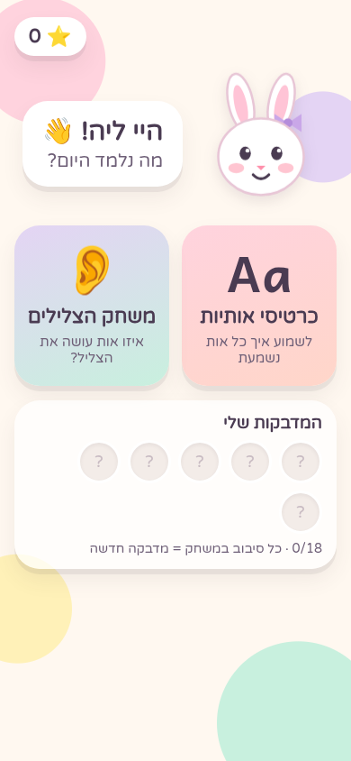
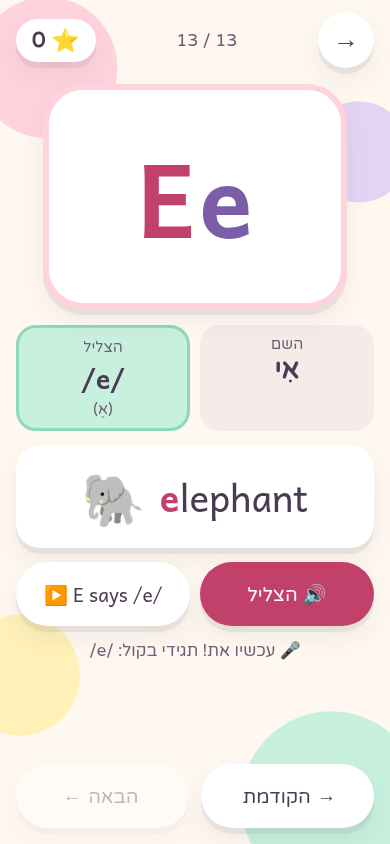
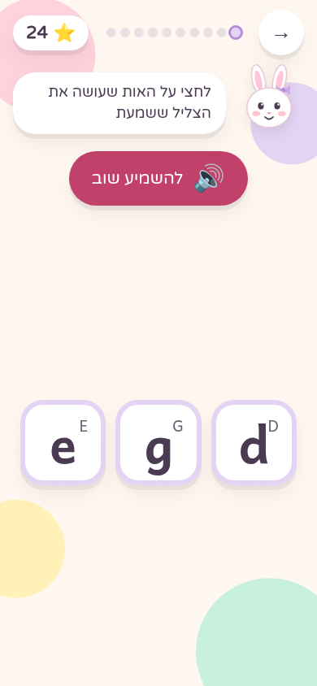
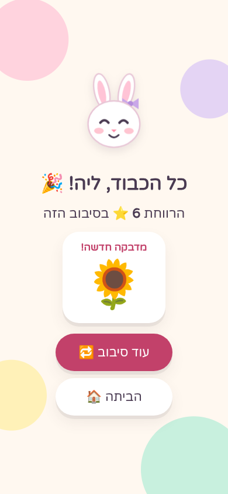

# Lia English 🐰

A small, personal phonics app that teaches Lia (4th grade, Hebrew speaker) the **sound** and **shape** of English letters.
Touch-first PWA for phone and tablet, both orientations. UI instructions are in Hebrew (RTL); learning content is in English.

**Live preview:** https://idocodev.github.io/lia-english/

| Home | Letter card | Sound game | Round end |
| --- | --- | --- | --- |
|  |  |  |  |

## What's in the POC

- **Home**: Mimi the bunny (original art) greets Lia by name, two big activities, star counter, sticker shelf.
- **Letter cards**: the first set in phonics order, `s a t p i n m d g o c k e` (with `e` for E/G practice).
  Big upper + lower case letter, keyword with a picture (🐐 goat), and the letter's **name** shown apart from its
  **sound** (`השם: גִ׳י · הצליל: /g/`), since mixing up names is where E/G confusion comes from.
  Opens with "G says /g/, like goat"; tap the letter or buttons to hear it again.
- **Sound game**: hear a sound, pick the letter out of 2 (or 3 once a letter gets stable).
  - Distractors come from known confusion pairs first (E/G now; b/d and p/q activate once those letters are added),
    then from letters Lia actually mixed up, then random. Letters with the same sound (c/k) are never offered together.
  - A miss is never a red "wrong": both letters are played side by side ("this is /g/, and this is /e/"), then she tries again.
  - Adaptive: Leitner boxes per letter; missed letters weigh more and come back 2 questions later in the same round.
- **Rewards**: a star per first-try answer, a sticker after each 10-question round, short sparkle bursts and chimes.
- **Progress** stays on the device (`localStorage`), including an append-only attempt log ready for syncing later.
- **PWA**: manifest, icons and a small service worker, so it can be added to the home screen and works offline.

## Run it

```bash
npm install
npm run dev       # http://localhost:5173
npm test          # engine unit tests (Vitest)
npm run build     # production build in dist/
```

Every push to `main` builds, tests and publishes `dist/` to the `gh-pages` branch (`.github/workflows/deploy.yml`).

## Code map

```
src/
  content/letters.ts   letters, names, sounds, keywords, confusion pairs (one typed file)
  content/stickers.ts  sticker set
  engine/engine.ts     adaptive engine: Leitner boxes, weighted picks, distractors, rounds (pure, tested)
  audio/audio.ts       the audio seam: recorded files first, Web Speech API fallback
  storage/local.ts     localStorage save/load, attempt log
  screens/             Home, LetterList, LetterCard, SoundGame
  components/          Mascot (SVG bunny), Sparkles, TopBar
```

## Recording your own voice

All sound goes through `src/audio/audio.ts`. Today it uses the browser's speech engine (en-US), which can't say
pure phonics sounds well (`/g/` comes out as "guh"). To swap in recordings:

1. Put files in `public/audio/`: `g.mp3` (just the sound) and `g-phrase.mp3` ("G says /g/, like goat").
2. Either add the letter id to `RECORDED` in `audio.ts`, or set `audio: { sound: 'g.mp3', phrase: 'g-phrase.mp3' }`
   on the letter in `content/letters.ts`.

Recorded files always win; letters without recordings keep using speech.

## Not in the POC (next steps)

- **Tracing**: dotted letter paths with stroke order (SVG + Pointer Events), important for b/d and p/q.
- **Word blending**: CVC words (`sat`, `pin`, `cat`) lighting up sound by sound, then the joined word.
- **Daily session flow**: review → new letter (only when earlier ones are in box 3+) → game → tracing → words → reward.
- **Spaced repetition across days** (box intervals 1-2-4-7-14 days) on top of the in-round repetition.
- **Recorded audio** (Ido's voice) and Hebrew spoken instructions.
- **Ido's dashboard**: letter map, confusions, streak; then remote sync (e.g. Supabase) of the attempt log.
- Remaining letters (u r h b f l j v w x y z q), custom illustrations, sticker album, parent settings.
